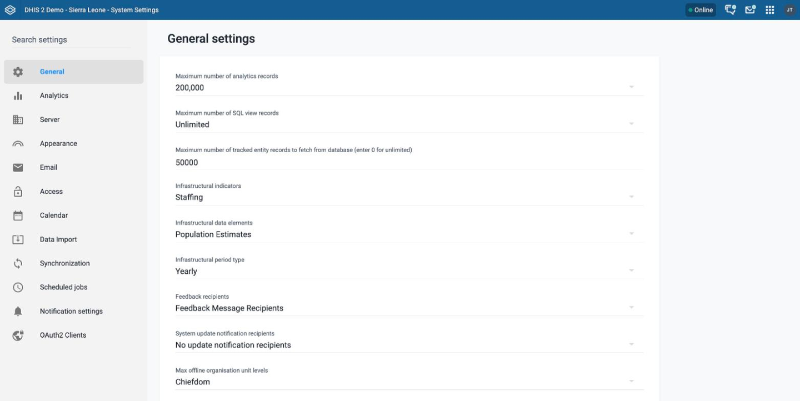
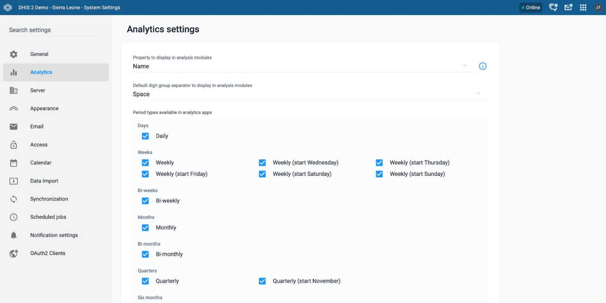
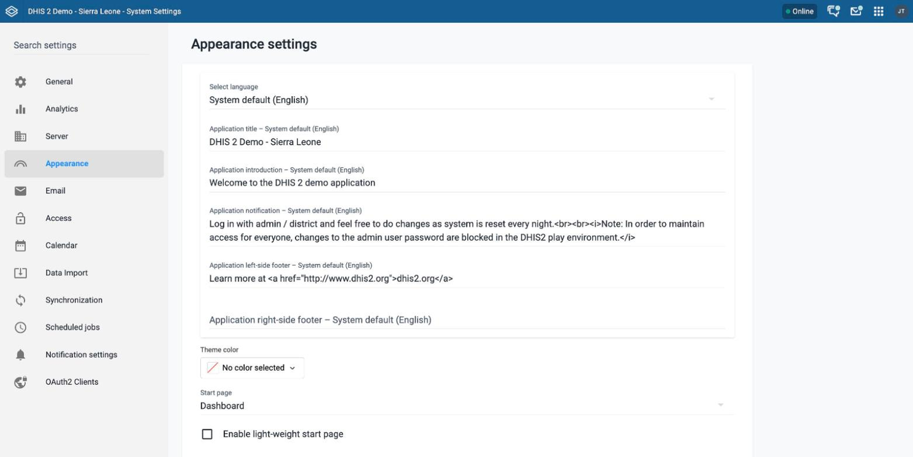
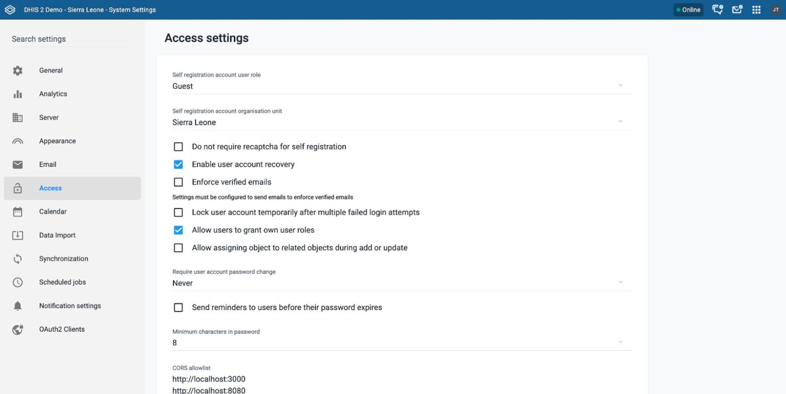
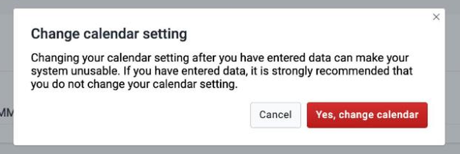
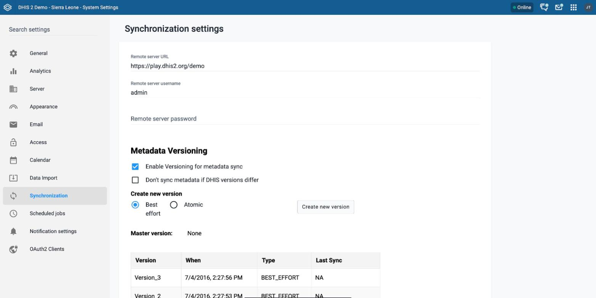
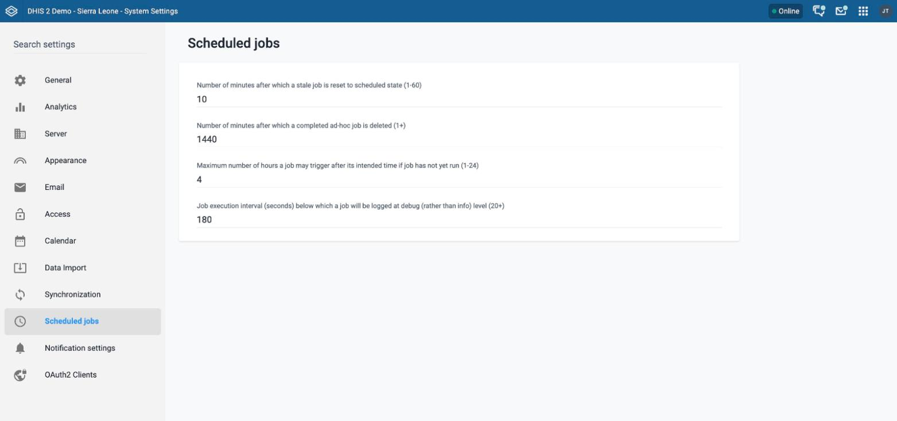

# System Settings { #settings }

In the **System Settings** app, you set options that apply to the whole DHIS2 instance. The app groups the settings into the categories that the following sections describe.

> **Warning**
>
> Some of the settings in this chapter apply only to specific core versions of DHIS2. Where the settings differ between versions, the text states the compatible versions.

## General settings { #system_general_settings }

Table: General settings

| Setting                                                                                     | Description                                                                                                                                                                                                                                                                                                                                                                                                                                                                                                                                                                                                                                                                                                                                                                                                                                                               |
| ------------------------------------------------------------------------------------------- | ------------------------------------------------------------------------------------------------------------------------------------------------------------------------------------------------------------------------------------------------------------------------------------------------------------------------------------------------------------------------------------------------------------------------------------------------------------------------------------------------------------------------------------------------------------------------------------------------------------------------------------------------------------------------------------------------------------------------------------------------------------------------------------------------------------------------------------------------------------------------- |
| **Maximum number of analytics records**                                                     | Increase this number to provide more records from the analytics.   The default value is 100,000.   **Warning**   Use the setting **Unlimited** carefully. It might cause a very high load on your server.                                                                                                                                                                                                                                                                                                                                                                                                                                                                                                                                                                                                                                               |
| **Maximum number of SQL view records**                                                      | Sets the maximum number of records in a SQL view.   The default value is Unlimited.                                                                                                                                                                                                                                                                                                                                                                                                                                                                                                                                                                                                                                                                                                                                                                                 |
| **Maximum number of tracked entity records to fetch from database (enter 0 for unlimited)** | Sets the limit on the maximum number of tracked entity records that DHIS2 can fetch from the database. If you do not enter a value, DHIS2 uses the default value of 50,000. If you set this to 0 or a negative integer, the limit is disabled. **Warning** Disabling this limit might cause a high load on the server.                                                                                                                                                                                                                                                                                                                                                                                                                                                                                                                                           |
| **Infrastructural indicators**                                                              | Defines an indicator group whose member indicators describe data about the infrastructure of organisation units.   **Note**   The **Maps** app, which replaced the GIS app, does not use this setting. To see data about an organisation unit in **Maps**, right-click the organisation unit and click **View profile**.                                                                                                                                                                                                                                                                                                                                                                                                                                                                                                                                      |
| **Infrastructural data elements**                                                           | Defines a data element group whose member data elements describe data about the infrastructure of organisation units.   Infrastructural data elements can be population, doctors, beds, internet connectivity, and climate.   **Note**   The **Maps** app, which replaced the GIS app, does not use this setting. To see data about an organisation unit in **Maps**, right-click the organisation unit and click **View profile**.                                                                                                                                                                                                                                                                                                                                                                                                                     |
| **Infrastructural period type**                                                             | Sets the frequency at which DHIS2 captures the data elements in the infrastructural data elements group.   This is typically yearly. When you view the infrastructural data, you can choose the time period of the data source.   **Note**   The **Maps** app, which replaced the GIS app, does not use this setting. To see data about an organisation unit in **Maps**, right-click the organisation unit and click **View profile**.                                                                                                                                                                                                                                                                                                                                                                                                                 |
| **Feedback recipients**                                                                     | Defines a user group whose members receive all messages that users send through the feedback function in the **Dashboard** app.   This group is typically the members of the super user team, who can support and answer questions from end users.                                                                                                                                                                                                                                                                                                                                                                                                                                                                                                                                                                                                                  |
| **System update notification recipients**                                                   | Defines a user group whose members receive messages about new system updates that are available for download. The recipients receive the message once for each new patch version of the DHIS2 installation that is available for download. If you do not define a user group, DHIS2 sends the message to all users that have the ALL authority.  You can disable this feature by setting the `system.update_notifications_enabled` configuration variable to `off` in the `dhis.conf` file. To check for updates, DHIS2 calls (GET, with no parameters) a REST API endpoint on a central server every day around 2:00 AM.  The URL is [https://releases.dhis2.org/v1/versions/stable.json](https://releases.dhis2.org/v1/versions/stable.json).  **Note** The DHIS2 core team does not log the details of any requests made to this versions API. |
| **Max offline organisation unit levels**                                                    | Defines how many levels of the organisation unit hierarchy are available offline in the organisation unit tree widget.   Under normal circumstances, you can leave this on the lowest level, which is the default setting.   You can set it to a higher level to reduce the initial load time when you have a large number of organisation units, typically more than 30,000.                                                                                                                                                                                                                                                                                                                                                                                                                                                                                 |
| **Data analysis std dev factor**                                                            | Sets the number of standard deviations that DHIS2 uses in the outlier analysis of captured data in the **Data Entry** app.   The default value is 2. A high value catches fewer outlier values than a low value.                                                                                                                                                                                                                                                                                                                                                                                                                                                                                                                                                                                                                                                    |
| **Phone number area code**                                                                  | The area code of the area where your deployment is located.   DHIS2 uses it to send and receive SMS. This is typically a country code.   Example: `+260` (the country code for Zambia)                                                                                                                                                                                                                                                                                                                                                                                                                                                                                                                                                                                                                                                                        |
| **Enable multi-organisation unit forms**                                                    | Enables support to enter data forms for multiple organisation units at the same time in the **Data Entry** app.   If you enable this setting, you can click the parent organisation unit in the **Data Entry** app for the children that you want to enter data for. The data set list then includes data sets that are assigned to the children of that parent.   **Note**   This setting works in the legacy **Data Entry** app. Support for that app ended in v42. The **System Settings** app shows this setting in v41 and earlier only. The setting is not available from v43.                                                                                                                                                                                                                                                                    |
| **Acceptance required before approval**                                                     | When this setting is enabled, DHIS2 requires acceptance of data before you can submit it to the next approval level.                                                                                                                                                                                                                                                                                                                                                                                                                                                                                                                                                                                                                                                                                                                                                      |
| **Gather analytical object statistics in dashboard views**                                  | Gathers usage analytics data when users view analytical objects (for example, maps and charts) in a dashboard. Without this setting, DHIS2 gathers analytics data on the objects only when users view them outside a dashboard.                                                                                                                                                                                                                                                                                                                                                                                                                                                                                                                                                                                                                                           |
| **Include passive dashboard views in usage analytics statistics**                           | Gathers usage analytics data on the first dashboard shown when you open the **Dashboard** app. Without this setting, DHIS2 counts only explicit dashboard selections.                                                                                                                                                                                                                                                                                                                                                                                                                                                                                                                                                                                                                                                                                                     |

#### v41 and earlier { #general_v41_and_earlier }

-   In v41 and earlier, the **System Settings** app shows the setting **Enable multi-organisation unit forms**. The setting works in the legacy **Data Entry** app.

#### v42 and later { #general_v42_and_later }

-   From v42, the **System Settings** app does not show the setting **Enable multi-organisation unit forms**. Support for the legacy **Data Entry** app ended in v42.

#### v43 and later { #general_v43_and_later }

-   From v43, the setting **Enable multi-organisation unit forms** is not available in DHIS2.

## Analytics settings { #system_analytics_settings }

Table: Analytics settings

| Setting                                                                                                                          | Description                                                                                                                                                                                                                                                                                                                                                                                                                                                                                                                                                                                                                                                                                                                                                                                                                                                                                |
| -------------------------------------------------------------------------------------------------------------------------------- | ------------------------------------------------------------------------------------------------------------------------------------------------------------------------------------------------------------------------------------------------------------------------------------------------------------------------------------------------------------------------------------------------------------------------------------------------------------------------------------------------------------------------------------------------------------------------------------------------------------------------------------------------------------------------------------------------------------------------------------------------------------------------------------------------------------------------------------------------------------------------------------------ |
| **Default relative period for analysis**                                                                                         | Defines the relative period that analytics apps, such as the **Data Visualizer** app and **Maps** app, use by default. DHIS2 chooses the relative period automatically when you open these apps.   Recommended setting: the most commonly used relative period among your users.                                                                                                                                                                                                                                                                                                                                                                                                                                                                                                                                                                                                     |
| **Property to display in analysis modules**                                                                                      | Sets whether analytics apps, such as the **Data Visualizer** app, **Maps** app, and **Line Listing** app, show the names or the short names of metadata objects.   Users can override this setting in the **Settings** app: **User settings** > **Property to display in analysis modules**.                                                                                                                                                                                                                                                                                                                                                                                                                                                                                                                                                                                         |
| **Default digit group separator to display in analysis modules**                                                                 | Sets the default digit group separator in analytics apps, such as the **Data Visualizer** app and **Line Listing** app.   The options are **Space**, **Comma**, and **None**.                                                                                                                                                                                                                                                                                                                                                                                                                                                                                                                                                                                                                                                                                                        |
| **Hide daily periods**, **Hide weekly periods**, **Hide biweekly periods**, **Hide monthly periods**, **Hide bimonthly periods** | Hide these period types in the analysis tools. The app shows these settings under **Hidden period types in analytics apps**.   **Note**   These settings are available in v42 and earlier. From v43, use **Period types available in analytics apps** instead.                                                                                                                                                                                                                                                                                                                                                                                                                                                                                                                                                                                                                 |
| **Period types available in analytics apps**                                                                                     | Controls which period types are available for data output in analytics apps. Use the checkboxes to enable or disable individual period types. Disabled types do not appear in analytics apps. Period types are grouped by frequency: daily, weekly, bi-weekly, monthly, bi-monthly, quarterly, six-monthly, and yearly (including financial year variants). The yearly period type is always enabled and cannot be disabled.   If a relative period setting uses a period type that you disable here, the app shows the message **This period type is currently disabled in the period type settings above** under that setting.   **Note**   This setting is available from v43. In earlier versions, use the individual **Hide daily periods**, **Hide weekly periods**, **Hide biweekly periods**, **Hide monthly periods**, and **Hide bimonthly periods** settings. |
| **Weekly relative period start day**                                                                                             | Defines which day of the week the relative weekly period starts on in analytics apps. The options are Monday (default), Wednesday, Thursday, Friday, Saturday, and Sunday.   **Note**   This setting is available from v43.                                                                                                                                                                                                                                                                                                                                                                                                                                                                                                                                                                                                                                                    |
| **Financial year relative period start month**                                                                                   | Defines which month the relative financial year in the analytics apps starts on. The options are April, July, and October. From v43, February, August, and September are also available.                                                                                                                                                                                                                                                                                                                                                                                                                                                                                                                                                                                                                                                                                                   |
| **Cache strategy**                                                                                                               | Decides how long DHIS2 caches reports analytics responses.   If you use the scheduled, nightly analytics update, you can choose **Cache until 6AM tomorrow**. Data in reports changes at that time, so you can safely cache data until the analytics tables are updated.   If you load data continuously into the analytics tables, choose **No cache**.   In other cases, choose the amount of time that you want to cache data.                                                                                                                                                                                                                                                                                                                                                                                                                                        |
| **Cacheability**                                                                                                                 | Sets whether DHIS2 serves analytics data responses with public or private visibility.   **Private**: No node or server between the DHIS2 server and the end user can cache the web page. This is useful if the page contains, or can contain, sensitive information. Each time you request a web page, you either get a new page from the DHIS2 server, or the DHIS2 server returns a page that it cached. No other server is allowed to cache the page.   **Public**: Any node or server between the DHIS2 server and the end user that can cache pages is allowed to cache the web page. This reduces the traffic to the DHIS2 server and can speed up later page loading.                                                                                                                                                                                                   |
| **Analytics cache mode**                                                                                                         | Supports two modes:   **Progressive**: This mode uses the progressive caching feature for analytics. When you enable it, it overrides the global caching strategy for analytics requests. It triggers HTTP and data layer caching for all analytics requests. When you use this mode, the _caching factor_ is required.   **Fixed**: DHIS2 caches requests for the period of time that you define in **Cache strategy**.                                                                                                                                                                                                                                                                                                                                                                                                                                                       |
| **Caching factor**                                                                                                               | Choose a value for the caching factor. This field is available only when you set **Analytics cache mode** to **Progressive**.   The list shows integers, and each integer is an absolute caching factor. DHIS2 uses the integer internally to calculate the final expiration time of each analytics request. A higher caching factor caches the request for longer.                                                                                                                                                                                                                                                                                                                                                                                                                                                                                                                  |
| **Max number of years to hide unapproved data in analytics**                                                                     | Sets whether analytics respects the approval level of the data, and for how long back in time. Data that is several years old is typically considered approved by default. To speed up analytics requests, you can choose to ignore the actual approval level of historical data.   **Never check approval**: DHIS2 hides no data, whatever the data approval status.   **Check approval for all data**: DHIS2 always checks the approval status.   Other options, for example **Last 3 years**: DHIS2 checks the approval status of data that is newer than 3 years. It does not check older data.                                                                                                                                                                                                                                                                      |
| **Respect category option start and end date in analytics table export**                                                         | Controls whether analytics filters data that is associated with a category option that has a start and end date, but is not associated with a period within the validity interval of the category option.                                                                                                                                                                                                                                                                                                                                                                                                                                                                                                                                                                                                                                                                                  |
| **Include zero data values in analytics tables**                                                                                 | Includes zero values in analytics tables. This applies only to data elements for which the **Store zero data values** property is enabled. Enabling **Store zero data values** on large numbers of data elements is strongly discouraged, because it can fill the analytics tables with zeros and cause unnecessary performance overhead.                                                                                                                                                                                                                                                                                                                                                                                                                                                                                                                                                  |
| **Enable embedded dashboards**                                                                                                   | If enabled, users see two modes of dashboard creation when they create a new dashboard: 1) Internal: the existing dashboard creation flow, based on data from the current instance, or 2) External: embed a dashboard built from data external to the instance.   **Note**   This setting is available from v42.                                                                                                                                                                                                                                                                                                                                                                                                                                                                                                                                                               |
| **Allow users to switch dashboard items view type**                                                                              | Allows users to switch the view of dashboard items between charts, pivot tables, and maps, using the dashboard item menu.                                                                                                                                                                                                                                                                                                                                                                                                                                                                                                                                                                                                                                                                                                                                                                  |
| **Allow users to open dashboard items in relevant app**                                                                          | Allows users to open dashboard items in the app for that type of item, using the dashboard item menu.                                                                                                                                                                                                                                                                                                                                                                                                                                                                                                                                                                                                                                                                                                                                                                                      |
| **Allow users to show dashboard items interpretations and details**                                                              | Allows users to see the interpretations and details of dashboard items, using the dashboard item menu.                                                                                                                                                                                                                                                                                                                                                                                                                                                                                                                                                                                                                                                                                                                                                                                     |
| **Allow users to view dashboard items in fullscreen**                                                                            | Allows users to view dashboard items in fullscreen, using the dashboard item menu.                                                                                                                                                                                                                                                                                                                                                                                                                                                                                                                                                                                                                                                                                                                                                                                                         |
| **Use centroids for organisation unit polygons in event analytics**                                                              | When enabled, DHIS2 creates analytics event tables using the centroid (center point) of each organisation unit polygon, instead of the full polygon geometry. This applies to data elements and tracked entity attributes of type organisation unit or organisation unit geometry.                                                                                                                                                                                                                                                                                                                                                                                                                                                                                                                                                                                                         |
| **Org unit group set in facility map layers**                                                                                    | Defines the default organisation unit group set that you can use to style facilities, with icons, in the **Maps** app.                                                                                                                                                                                                                                                                                                                                                                                                                                                                                                                                                                                                                                                                                                                                                                     |
| **Org unit level in facility map layers**                                                                                        | Defines the default level for facility layers in the **Maps** app. The app shows the organisation units of the default level, unless a user chooses a different level for a layer.                                                                                                                                                                                                                                                                                                                                                                                                                                                                                                                                                                                                                                                                                                         |
| **Default basemap**                                                                                                              | Sets the basemap that the **Maps** app uses by default. If you do not choose a value, DHIS2 uses **OSM Light**.   The options are **OSM Light**, **OSM Detailed**, **Bing Road**, **Bing Dark**, **Bing Aerial**, and **Bing Aerial Labels**.                                                                                                                                                                                                                                                                                                                                                                                                                                                                                                                                                                                                                                        |

#### v42 and earlier { #analytics_v42_and_earlier }

-   In v42 and earlier, the **System Settings** app shows the settings **Hide daily periods**, **Hide weekly periods**, **Hide biweekly periods**, **Hide monthly periods**, and **Hide bimonthly periods**.

#### v42 and later { #analytics_v42_and_later }

-   From v42, the setting **Enable embedded dashboards** is available in the **System Settings** app.

#### v43 and later { #analytics_v43_and_later }

-   From v43, the setting **Period types available in analytics apps** replaces the five settings **Hide daily periods**, **Hide weekly periods**, **Hide biweekly periods**, **Hide monthly periods**, and **Hide bimonthly periods**.
-   From v43, the setting **Weekly relative period start day** is available in the **System Settings** app.
-   From v43, the setting **Financial year relative period start month** also offers the options **February**, **August**, and **September**.

## Server settings { #system_server_settings }

Table: Server settings

| Setting                                        | Description                                                                                                                                                                                                                                                                                                                                                |
| ---------------------------------------------- | ---------------------------------------------------------------------------------------------------------------------------------------------------------------------------------------------------------------------------------------------------------------------------------------------------------------------------------------------------------- |
| **Number of database server CPUs**             | Sets the number of CPU cores of your database server.   This lets the system perform optimally when the database is hosted on a different server than the application server, because analytics in DHIS2 scales linearly with the number of available cores.   The options are **Automatic (detect based on web server)**, 1 to 8, 16, and 32. |
| **System notifications email address**         | Defines the email address that receives system notifications.   DHIS2 sends notifications about failures in processes, such as analytics table generation, to this address. This is useful for application monitoring.                                                                                                                               |
| **Google Analytics (Universal Analytics) key** | Sets the Google UA key to provide usage analytics for your DHIS2 instance through the Google Analytics platform. Not all apps in DHIS2 support Google Analytics, so some activity of your users might not appear in this platform.   For more information about Google Analytics, see [google.com/analytics](https://google.com/analytics).          |
| **Google Maps API key**                        | Defines the API key for the Google Maps API. Use this key to view Google map layers in DHIS2. Enabling Google Earth Engine layers in the DHIS2 **Maps** app needs a different key setup. See the [documentation](https://docs.dhis2.org/en/topics/tutorials/google-earth-engine-sign-up.html).                                                             |
| **Bing Maps API key**                          | Defines the API key for the Bing Maps API. Add this key to enable Bing basemaps in the DHIS2 **Maps** app. See the [Bing Maps API key documentation](https://www.microsoft.com/en-us/maps/bing-maps/create-a-bing-maps-key) for information about how to set up the key.                                                                                   |
| **Azure Maps API key**                         | Defines the API key for Azure Maps.                                                                                                                                                                                                                                                                                                                        |

## Appearance settings { #system_appearance_settings }

Table: Appearance settings

| Setting                                           | Description                                                                                                                                                                                                                                                                                                                                                                                                                                                                                                                           |
| ------------------------------------------------- | ------------------------------------------------------------------------------------------------------------------------------------------------------------------------------------------------------------------------------------------------------------------------------------------------------------------------------------------------------------------------------------------------------------------------------------------------------------------------------------------------------------------------------------- |
| **Select language**                               | Sets the language for which you can then enter translations of the following settings:  - **Application title**  - **Application introduction**  - **Application notification**  - **Application left-side footer**  - **Application right-side footer**   **Note**   Before each of these settings can accept a translated value, it needs a default or fallback value. To set this value, choose the option that starts with **System default**, for example **System default (English)**, in this menu. |
| **Application title**                             | Sets the application title in the top menu.                                                                                                                                                                                                                                                                                                                                                                                                                                                                                           |
| **Application introduction**                      | Sets an introduction of the system, which is visible on the top-left part of the login page.                                                                                                                                                                                                                                                                                                                                                                                                                                          |
| **Application notification**                      | Sets a notification, which is visible on the front page under the login area.                                                                                                                                                                                                                                                                                                                                                                                                                                                         |
| **Application left-side footer**                  | Sets a text in the left-side footer area of the login page. (When you use a language written in a right-to-left script, such as Arabic, the text is in the right footer area of the login page.)                                                                                                                                                                                                                                                                                                                                      |
| **Application right-side footer**                 | Sets a text in the right-side footer area of the login page. (When you use a language written in a right-to-left script, such as Arabic, the text is in the left footer area of the login page.)                                                                                                                                                                                                                                                                                                                                      |
| **Style (android)**                               | This setting influences the style (look and feel) of the DHIS2 Android app. This style does not apply to web apps in general.   **Note**   This setting is available in v42 and earlier. From v43, use **Theme color** instead.                                                                                                                                                                                                                                                                                           |
| **Theme color**                                   | This color picker sets the color of the DHIS2 header bar in all web apps and the theme in the Android app. After you set a color, refresh the page to see the change. The Global Shell must be enabled to see the custom color in the header bar on web. If a color is set, click **Remove color** to return to the default color.   **Note**   This setting is available from v43.                                                                                                                                       |
| **Start page**                                    | Sets the page or app that users are sent to after they log in.   Recommended setting: the **Dashboard** app.                                                                                                                                                                                                                                                                                                                                                                                                                    |
| **Enable light-weight start page**                | Instructs apps to show a light-weight and fast landing page. Recommended in low-bandwidth environments.                                                                                                                                                                                                                                                                                                                                                                                                                               |
| **Help page link**                                | Defines the URL that users see when they click **Profile** > **Help**.                                                                                                                                                                                                                                                                                                                                                                                                                                                                |
| **Flag**                                          | Sets the flag that is shown in the left menu of the **Dashboard** app.                                                                                                                                                                                                                                                                                                                                                                                                                                                                |
| **Interface language**                            | Sets the language that the user interface uses.   Users can override this setting in the **Settings** app: **User settings** > **Interface language**.                                                                                                                                                                                                                                                                                                                                                                          |
| **Database language**                             | Sets the language that the database uses.   Users can override this setting in the **Settings** app: **User settings** > **Database language**.                                                                                                                                                                                                                                                                                                                                                                                 |
| **Require authority to add to view object lists** | If you choose this option, DHIS2 hides menu and index page items and links to lists of objects when the current user does not have the authority to create that type of object (privately or publicly).                                                                                                                                                                                                                                                                                                                               |
| **Custom top menu logo**                          | Choose this option and upload an image to add your logo to the left side of the top menu.                                                                                                                                                                                                                                                                                                                                                                                                                                             |
| **Custom login page logo**                        | Choose this option and upload an image to add your logo to the login page.                                                                                                                                                                                                                                                                                                                                                                                                                                                            |
| **Login page theme**                              | Lets you choose between the default layout, the sidebar layout, or a custom layout for the login app. If you choose a custom layout, you must provide a custom template in **Login page template**.                                                                                                                                                                                                                                                                                                                                   |
| **Login page template**                           | Paste the HTML that defines the layout and style of the login page here. The developer documentation has more details about how to define the template.                                                                                                                                                                                                                                                                                                                                                                               |
| **Enable Global Shell**                           | When this property is enabled (set to true, the default), the Global Shell provides a common interface and navigation tools across all DHIS2 web apps.   You can find more technical details about the Global Shell [in the Developer Portal](https://developers.dhis2.org/docs/references/global-shell).   **Note**   This setting is available from v42.                                                                                                                                                          |
| **Enable custom translations**                    | With this option enabled, apps can use custom translations that are set in the datastore. For more information, see the Localization of DHIS2 page.   **Note**   This setting is available from v43.                                                                                                                                                                                                                                                                                                                      |

#### v42 and earlier { #appearance_v42_and_earlier }

-   In v42 and earlier, the **System Settings** app shows the setting **Style (android)**.

#### v42 and later { #appearance_v42_and_later }

-   From v42, the setting **Enable Global Shell** is available in the **System Settings** app.

#### v43 and later { #appearance_v43_and_later }

-   From v43, the setting **Theme color** replaces the setting **Style (android)**.
-   From v43, the setting **Enable custom translations** is available in the **System Settings** app.

## Email settings { #system_email_settings }

Table: Email settings

| Setting                  | Description                                                                                                                 |
| ------------------------ | --------------------------------------------------------------------------------------------------------------------------- |
| **Host name**            | Sets the host name of the SMTP server.   When you use Google SMTP services, the host name should be _smtp.gmail.com_. |
| **Port**                 | Sets the port that DHIS2 uses to connect to the SMTP server.   The options are 587, 465, and 25.                      |
| **Username**             | The user name of the user account on the SMTP server.   Example: `mail@dhis2.org`                                     |
| **Password**             | The password of the user account on the SMTP server.                                                                        |
| **TLS**                  | Choose this option if the SMTP server requires TLS for connections.                                                         |
| **Email sender**         | The email address to use as the sender when DHIS2 sends emails.                                                             |
| **Send me a test email** | Sends a test email to the user who is logged in to DHIS2.                                                                   |

## Access settings { #system_access_settings }

Table: Access settings

| Setting                                                                | Description                                                                                                                                                                                                                                                                                                                                                                                                                                                                                                                                                        |
| ---------------------------------------------------------------------- | ------------------------------------------------------------------------------------------------------------------------------------------------------------------------------------------------------------------------------------------------------------------------------------------------------------------------------------------------------------------------------------------------------------------------------------------------------------------------------------------------------------------------------------------------------------------ |
| **Self registration account user role**                                | Defines which user role DHIS2 gives to self-registered user accounts.   To enable self-registration of users, choose any user role from the list. DHIS2 shows a link to the self-registration form on the login page.   **Note**   To enable self-registration, you must also choose a **Self registration account organisation unit**.   To disable self-registration of users, choose **Disable self registration**.                                                                                                                     |
| **Self registration account organisation unit**                        | Defines which organisation unit DHIS2 associates with self-registered users.   **Note**   To enable self-registration, you must also choose a **Self registration account user role**.                                                                                                                                                                                                                                                                                                                                                                 |
| **Do not require recaptcha for self registration**                     | Defines whether you want to use reCAPTCHA for user self-registration. reCAPTCHA is enabled by default.                                                                                                                                                                                                                                                                                                                                                                                                                                                             |
| **Enable user account recovery**                                       | Defines whether users can restore their own passwords.   When this setting is enabled, DHIS2 shows a link to the account recovery form on the front page.   **Note**   User account recovery requires that you have configured email settings (SMTP).                                                                                                                                                                                                                                                                                            |
| **Enforce verified emails**                                            | Controls whether users must verify their email addresses before they access the system. You can enable this setting only if the system is configured to send emails (SMTP).   **Note**   If the **Host name** or **Username** values are not set in the **Email** settings, you cannot enable **Enforce verified emails**. If these settings are missing and **Enforce verified emails** is already enabled, you can disable it, but you cannot enable it again until you set the required email settings.   This setting is available from v42. |
| **Lock user account temporarily after multiple failed login attempts** | Defines whether the system locks user accounts after five successive failed login attempts over a timespan of 15 minutes.   The account is locked for 15 minutes, and then the user can try to log in again.                                                                                                                                                                                                                                                                                                                                                 |
| **Allow users to grant own user roles**                                | Defines whether users can grant the user roles that they have themselves to others when they create new users.                                                                                                                                                                                                                                                                                                                                                                                                                                                     |
| **Allow assigning object to related objects during add or update**     | Defines whether users can assign an object to a related object when they create or edit metadata objects.   For example, you can allow users to assign an organisation unit to data sets and organisation unit group sets when they create or edit the organisation unit.                                                                                                                                                                                                                                                                                    |
| **Require user account password change**                               | Defines whether users must change their passwords every 3, 6, or 12 months.   If you do not want to force users to change their password, choose **Never**.                                                                                                                                                                                                                                                                                                                                                                                                  |
| **Send reminders to users before their password expires**              | When set, users receive a notification when their password is about to expire.                                                                                                                                                                                                                                                                                                                                                                                                                                                                                     |
| **Number of days before password expiry to send reminder (1–28)**      | DHIS2 shows this setting if you choose to send reminders to users before their password expires. Enter a number from 1 to 28 for the number of days before password expiry that DHIS2 sends the email.                                                                                                                                                                                                                                                                                                                                                             |
| **Minimum characters in password**                                     | Defines the minimum number of characters that users must have in their passwords.   You can choose 8 (default), 10, 12, or 14.                                                                                                                                                                                                                                                                                                                                                                                                                               |
| **CORS allowlist**                                                     | Allowlists a set of URLs that can access the DHIS2 API from another domain. Enter each URL on a separate line. Cross-origin resource sharing (CORS) is a mechanism that allows a web page to request restricted resources (for example, JavaScript files) from a domain outside the domain that served the first resource.                                                                                                                                                                                                                                         |
| **reCAPTCHA Site Key**, **reCAPTCHA Secret Key**                       | Set the site key and the secret key for reCAPTCHA. The app hides the values that you enter in both fields.                                                                                                                                                                                                                                                                                                                                                                                                                                                         |

#### v42 and later { #access_v42_and_later }

-   From v42, the setting **Enforce verified emails** is available in the **System Settings** app.

## Notification settings { #system_notification_settings }

Table: Notification settings

| Setting                                     | Description                                                                                                                                                                                                                                                                                                       |
| ------------------------------------------- | ----------------------------------------------------------------------------------------------------------------------------------------------------------------------------------------------------------------------------------------------------------------------------------------------------------------- |
| **Log level**                               | The level of messages to include in the log or list. The default is `DEBUG` (all). API key: `notifierLogLevel`.                                                                                                                                                                                                   |
| **Max messages per job**                    | Each job can have at most this number of messages in its list. DHIS2 enforces this limit softly, so a job can exceed it momentarily by a few messages. The default is `500`. API key: `notifierMaxMessagesPerJob`.                                                                                                |
| **Max age in days**                         | DHIS2 discards job data that is older than this number of days. DHIS2 enforces this limit softly and cleans up after the idle time that you set in **Clean idle jobs after (in milliseconds)**. The default is `7`. API key: `notifierMaxAgeDays`.                                                                |
| **Max jobs per type**                       | If more than this number of jobs with data exist for a job type, DHIS2 discards the oldest jobs to get below this limit. DHIS2 enforces this limit softly and cleans up after the idle time that you set in **Clean idle jobs after (in milliseconds)**. The default is `500`. API key: `notifierMaxJobsPerType`. |
| **Clean idle jobs after (in milliseconds)** | The time in milliseconds that the notifier must be idle (not moving messages from the queue to the store) before DHIS2 runs an automatic store cleanup. The cleanup uses **Max age in days** and **Max jobs per type** as limits. The default is `600000` (10 minutes). API key: `notifierCleanAfterIdleTime`.    |
| **Enable Gist Overview**                    | When enabled, the overview pages show only the first and the last message of the list for each job. The default is `true`. API key: `notifierGistOverview`.                                                                                                                                                       |

## Calendar settings { #system_calendar_settings }

{ width=60% }

Table: Calendar settings

| Setting         | Description                                                                                                                                                                                                                                                                                                                                                                                                                                                                                                                                                                                                                                                                                                                                                                                                                                                                                               |
| --------------- | --------------------------------------------------------------------------------------------------------------------------------------------------------------------------------------------------------------------------------------------------------------------------------------------------------------------------------------------------------------------------------------------------------------------------------------------------------------------------------------------------------------------------------------------------------------------------------------------------------------------------------------------------------------------------------------------------------------------------------------------------------------------------------------------------------------------------------------------------------------------------------------------------------- |
| **Calendar**    | Defines which calendar the system uses.   The system supports the following calendars: Coptic, Ethiopian, Gregorian, Islamic (Lunar Hijri), ISO 8601, Julian, Nepali, Persian (Solar Hijri), and Thai.  This is a system-wide setting. You cannot have multiple calendars in a single DHIS2 instance.  For more information about the difference between Gregorian and ISO 8601, see [ISO 8601 week dates](https://en.wikipedia.org/wiki/ISO_8601#Week_dates).  **Warning**  Changing your calendar setting after you have entered data can make your system unusable. If you have entered data, it is strongly recommended that you do not change your calendar setting. When you choose a different calendar, DHIS2 shows the **Change calendar setting** dialog. Click **Cancel** to keep the current calendar, or click **Yes, change calendar** to confirm the change. |
| **Date format** | Defines which date format the system uses.   The options are `yyyy-MM-dd` (for example 1981-03-31) and `dd-MM-yyyy` (for example 31-03-1981).                                                                                                                                                                                                                                                                                                                                                                                                                                                                                                                                                                                                                                                                                                                                                       |

## Data import settings { #system_data_import_settings }

The data import settings apply to extra controls that you can enable to validate aggregate data that you import through the web API. They provide optional constraints on what DHIS2 treats as a conflict during import. DHIS2 applies the constraints to each individual data value in the import.

Table: Data import settings

| Setting                                                                    | Description                                                                                                                                                                                 |
| -------------------------------------------------------------------------- | ------------------------------------------------------------------------------------------------------------------------------------------------------------------------------------------- |
| **Require periods to match period type of data set**                       | Requires the period of a data value to have the same period type as the data sets that the data element of the data value is assigned to.                                                   |
| **Require data elements to be part of data set**                           | Requires the data element of a data value to be assigned to a data set. If you specify a data set on import, the system checks that data values are associated with the specified data set. |
| **Require category option combos to match category combo of data element** | Requires the category option combination of a data value to be part of the category combination of the data element of the data value.                                                      |
| **Require organisation units to match assignment of data set**             | Requires the organisation unit of a data value to be assigned to one or more of the data sets that the data element of the data value is assigned to.                                       |
| **Require attribute option combos to match category combo of data set**    | Requires the attribute option combination of a data value to be part of the category combination of the data set that the data element of the data value is assigned to.                    |
| **Require category option combo to be specified**                          | Requires the category option combination of a data value to be specified.   By default, DHIS2 uses the default category option combination if you do not specify one.                 |
| **Require attribute option combo to be specified**                         | Requires the attribute option combination of a data value to be specified.   By default, DHIS2 uses the default attribute option combination if you do not specify one.               |

## Synchronization settings { #system_synchronization_settings }

The following settings are used for both data and metadata synchronization.

> **Note**
>
> For more information about how to configure metadata synchronization, see [Configure metadata synchronizing](https://docs.dhis2.org/en/use/user-guides/dhis-core-version-master/exchanging-data/metadata-synchronization.html).

Table: Synchronization settings

| Setting                                         | Description                                                                                                                                                                                                                                                                                                                                                                                                                                                                                                                                      |
| ----------------------------------------------- | ------------------------------------------------------------------------------------------------------------------------------------------------------------------------------------------------------------------------------------------------------------------------------------------------------------------------------------------------------------------------------------------------------------------------------------------------------------------------------------------------------------------------------------------------ |
| **Remote server URL**                           | Defines the URL of the remote server that runs DHIS2 and receives the uploaded data values.   Use SSL/HTTPS, because DHIS2 sends the user name and password with the request (using basic authentication).   The system tries to synchronize data once every minute.   The system also uses this setting for metadata synchronization.   **Note**   To enable data and metadata synchronization, you must also enable the **Data synchronization** and **Metadata synchronization** jobs in the **Scheduler** app. |
| **Remote server username**                      | The user name of the DHIS2 user account on the remote server to use for data synchronization.   **Note**   If you enable metadata versioning, make sure that the configured user has the authority `F_METADATA_MANAGE`.                                                                                                                                                                                                                                                                                                              |
| **Remote server password**                      | The password of the DHIS2 user account on the remote server. DHIS2 stores the password encrypted.                                                                                                                                                                                                                                                                                                                                                                                                                                                |
| **Enable Versioning for metadata sync**         | Defines whether DHIS2 creates versions of metadata when you synchronize metadata between central and local instances.   When you enable this setting, the **Metadata Versioning** section shows **Create new version** and the list of metadata versions. See [Create a metadata version](#create_metadata_version).                                                                                                                                                                                                                       |
| **Don't sync metadata if DHIS versions differ** | The metadata schema changes between versions of DHIS2, which can make different metadata versions incompatible.   When enabled, this option does not allow metadata synchronization when the central and local instances have different DHIS2 versions. This applies to metadata synchronization through both the user interface and the API.   The only time you might want to disable this option is when you synchronize basic entities, for example data elements, that have not changed across DHIS2 versions.                  |
| **Best effort**                                 | A type of metadata version that decides how the importer on the local instances handles the metadata version.   _Best effort_ means that if the metadata import finds missing references (for example, missing data elements on a data element group import), it ignores the errors and continues the import.                                                                                                                                                                                                                              |
| **Atomic**                                      | A type of metadata version that decides how the importer on the local instances handles the metadata version.   _Atomic_ means all or nothing: the metadata import fails if any of the references do not exist.                                                                                                                                                                                                                                                                                                                            |

### Create a metadata version { #create_metadata_version }

The **Metadata Versioning** section appears only when you enable **Enable Versioning for metadata sync**. In this section you create a version of the metadata on the instance and see the existing versions.

1.  Open the **System Settings** app and click **Synchronization**.

2.  Choose the checkbox **Enable Versioning for metadata sync**.

3.  In **Create new version**, choose **Best effort** or **Atomic**. This is the type of the new version. The **Best effort** and **Atomic** rows in the previous table describe each type.

4.  Click **Create new version**.

The app shows the message **Version created**. If DHIS2 cannot create the version, the app shows **Failed to create version**. While DHIS2 creates the version, the options and the button are disabled.

The section also shows the following information:

-   **Master version:** shows the name of the master version, or **None**. On an instance with a **Remote server URL**, this is the version that the remote server reports. On other instances, it is the newest version that you created.
-   A table of versions with the columns **Version**, **When**, **Type**, and **Last Sync**.
-   **Last sync attempt:** shows the version, **Failed**, and the time, on an instance with a **Remote server URL**, when the last metadata synchronization failed.
-   **No versions exist** when no version has been created.

## Scheduled jobs { #system_scheduled_jobs_settings }

These settings control how DHIS2 handles scheduled jobs. To create and manage the jobs themselves, use the **Scheduler** app.

Table: Scheduled jobs settings

| Setting                                                                                                       | Description                                                                                                                               |
| ------------------------------------------------------------------------------------------------------------- | ----------------------------------------------------------------------------------------------------------------------------------------- |
| **Number of minutes after which a stale job is reset to scheduled state (1-60)**                              | Sets the number of minutes after which DHIS2 resets a stale job to the scheduled state. Enter a number from 1 to 60.                      |
| **Number of minutes after which a completed ad-hoc job is deleted (1+)**                                      | Sets the number of minutes after which DHIS2 deletes a completed ad-hoc job. Enter 1 or more.                                             |
| **Maximum number of hours a job may trigger after its intended time if job has not yet run (1-24)**           | Sets the maximum number of hours that a job may still trigger after its intended time if it has not yet run. Enter a number from 1 to 24. |
| **Job execution interval (seconds) below which a job will be logged at debug (rather than info) level (20+)** | Sets the job execution interval, in seconds, below which DHIS2 logs a job at debug level instead of info level. Enter 20 or more.         |

## OAuth2 Clients { #system_oauth2_settings }

You create, edit, and delete OAuth2 clients in the **System Settings** app. You need the authority `F_OAUTH2_CLIENT_MANAGE` to use **OAuth2 Clients**.

The list of clients shows the **Client ID** and whether each client uses **Refresh token** and **Authorization code**. To change a client, click **Edit** in its row. To remove a client, click **Delete**.

1.  Open the **System Settings** app and click **OAuth2 Clients**.

2.  Click **Add OAuth2 client**.

3.  Enter the **Client ID**. The app fills in a generated value for **Client Secret**.

4.  For **Grant Types**, choose **Refresh token**, **Authorization code**, or both.

5.  Enter the **Redirect URIs**. Enter each URI on a separate line.

6.  Click **Save**.

#### v41 and earlier { #oauth2_v41_and_earlier }

-   In v41 and earlier, the form to add an OAuth2 client in the **System Settings** app has a required **Name** field.
-   In v41 and earlier, the field **Grant Types** includes the option **Password**.

#### v42 and later { #oauth2_v42_and_later }

-   From v42, the form to add an OAuth2 client in the **System Settings** app has no **Name** field, and the field **Grant Types** does not include the option **Password**.
